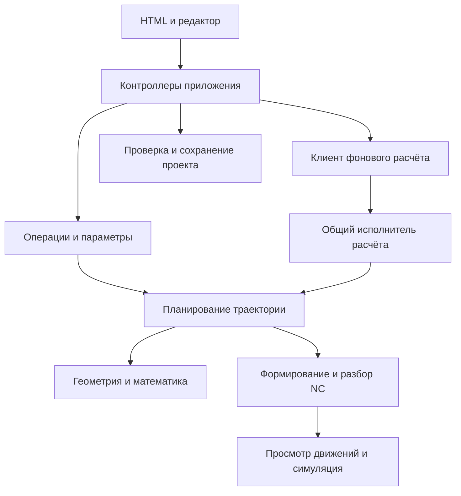

# Архитектура

## Запуск и сборка

`src/main.js` устанавливает совместимость браузера, публикует прежний API для отладки и запускает `startApplication()`. Все рабочие зависимости импортируются через ES modules. Расчётные модули не читают `window`, DOM или localStorage.

`scripts/build.mjs` собирает Web Worker, затем приложение, CSS и HTML. Worker передаётся сборщику через виртуальный импорт `atlanta:worker` и включается в итоговый файл строкой. Приложение создаёт его через Blob, поэтому фоновый расчёт работает и при открытии автономного HTML через `file://`.

Результаты сборки:

| Файл                                     | Назначение                                       |
| ---------------------------------------- | ------------------------------------------------ |
| `dist/ATLANTA-Contour-Offline-3.89.html` | Один файл для пользователя, без внешних ресурсов |
| `dist/index.html`, `app.js`, `style.css` | Вариант для локального сервера разработки        |
| `dist/app.js.map`                        | Карта соответствия сборки исходникам             |
| `dist/worker.js`                         | Читаемая сборка фонового расчёта                 |
| `dist/manifest.json`                     | Версия и SHA-256 автономного HTML                |

Версия берётся из `package.json`. При сборке она подставляется в шаблоны и в `__APP_VERSION__`. У проекта JSON своя версия формата — `5`; номер приложения не должен автоматически менять формат проекта.

## Поток данных

Это схема ответственности. Точные связи между файлами проверяются `npm run check`: отсутствуют циклические импорты, неизвестные глобальные переменные и зависимости расчётного слоя от браузерного.

## Границы модулей

| Где                                                                    | Ответственность                                                                                |
| ---------------------------------------------------------------------- | ---------------------------------------------------------------------------------------------- |
| `core/math.js`, `segments.js`, `spatial.js`, `contours.js`             | Векторная математика, сегменты, пространственный поиск, соединение и смещение контуров         |
| `core/planes.js`                                                       | Единственное место сопоставления локальных и физических осей                                   |
| `formats/`                                                             | Чтение и запись DXF, импорт эскиза                                                             |
| `geometry/`                                                            | Построение и восстановление элементов, привязки, ноль, размерные выражения                     |
| `cam/machines.js`                                                      | Профиль станка, выбор стратегии и параметры инструмента                                        |
| `cam/entry.js`, `open-wall.js`, `wall-network.js`                      | Заходы и обработка открытых стенок                                                             |
| `nc/interpreter.js`, `parser.js`, `subprograms.js`, `g25-execution.js` | Модальные команды, подпрограммы и исполнение повторов                                          |
| `nc/controller.js`                                                     | Планирование и проверка радиусной коррекции на стойке                                          |
| `nc/z-reference.js`                                                    | Физическая привязка Z по поверхности, плитке и радиусу; прежний режим при отсутствии настройки |
| `operations/`                                                          | Сборка нескольких операций, инструменты, сверление, круговые циклы и реверс                    |
| `app/*-controller.js`                                                  | Реакция интерфейса на действия пользователя                                                    |
| `ui/editor/`                                                           | История, выделение, буфер, построения, размеры и отрисовка редактора                           |
| `workers/task.js`                                                      | Общий расчёт для Worker и выполнения в текущем окне                                            |

`core/index.js` и `engine.js` предоставляют совместимый публичный интерфейс. Расчётные модули импортируют нужные функции непосредственно из их файлов. `platform/legacy-api.js` отдельно публикует совместимые имена `CAM`, `MACHINES`, `SKETCH` и другие для прежних интеграций и тестирования. Внутренние модули не получают зависимости из этих глобальных объектов.

## Состояние и контроллеры интерфейса

`app/state.js` создаёт новое состояние; `app/parameter-schema.js` содержит группы полей, значения по умолчанию и ключи хранения. `app/application.js` связывает состояние, контроллеры, редактор и события DOM. `ui/editor/editor.js` выполняет такую же роль для редактора; определения его полей находятся в `ui/editor/schema.js`.

Контроллеры создаются функциями `create…(deps)`. Их зависимости перечислены в JSDoc. Контекст передаёт живые значения через getters/setters: при замене результата, операции или выделения остальные контроллеры видят актуальные данные. Контекст собирается один раз, а не дублируется для каждого контроллера.

**Фабрика контроллера только объявляет обработчики.** Чтение контекста и работа с DOM должны происходить при вызове обработчика после инициализации приложения. Не добавляйте действия на верхнем уровне фабрики: часть значений создаётся позже в том же корне сборки.

Это поэтапная декомпозиция существующего приложения. Корни интерфейса ещё содержат обработчики событий и связывание состояния; крупные алгоритмы интерпретации и коррекции сохранены без переписывания математической модели.

## HTML и CSS

`ui/templates/index.html` задаёт документ. Директивы `<!-- include: … -->` разрешаются относительно `ui/templates/`; включения с выходом из этой папки и циклы запрещены. Основной макет, настройки, рабочая область, панель кода и диалоги находятся в отдельных файлах.

`styles/index.css` задаёт порядок десяти файлов каскада. `theme.css` содержит поздние переопределения прежнего дизайна. Переставлять импорты нельзя без проверки внешнего вида. В 3.89 добавлен раздел привязки Z и изменён начальный выбор нуля; остальной DOM сравнивается с эталоном 3.87.

## Привязка и локальная траектория

`configuration-controller.js` определяет физическую координату поверхности касания относительно выбранного нуля. Для XZ/YZ используется верх всего чертежа, для XY — `topZ`; ручной режим задаёт её явно. `nc/z-reference.js` прибавляет плитку и D/2, проверяет диапазон и формирует G92 с комментарием. Это параметр операции.

Планировщик работает в локальной системе плоскости с собственной безопасной высотой; она не равна автоматически физической привязке. `operations/assembly.js` устанавливает физический G92, пересчитывает первый ход при преобразовании в G91 и проверяет возврат по результату разбора итогового NC. Нельзя подменять локальную высоту углубления значением физической Z в XZ/YZ. Настройка привязки не прибавляется к геометрии контура.
